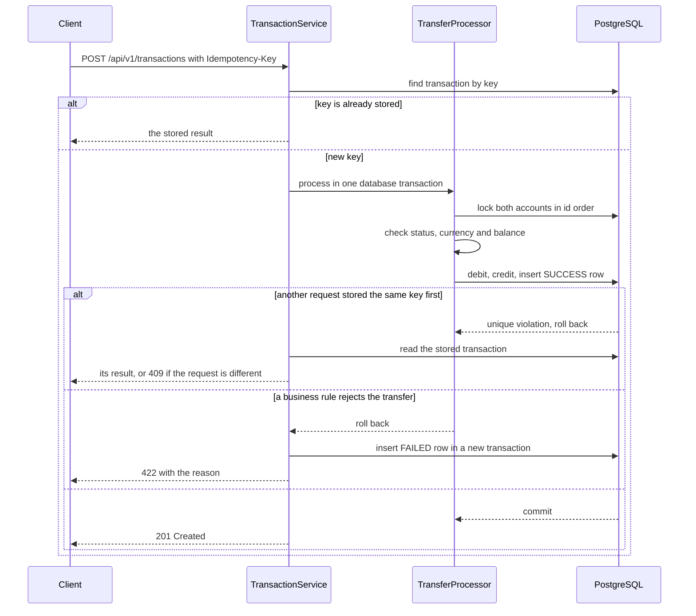

# Idempotent Transfer Service

[](https://github.com/luka7n/idempotent-transfer-service/actions/workflows/build.yml)

A Spring Boot service that moves money between accounts and stays correct when clients retry
requests or send them at the same time. I built it with Java 21, Spring Boot 4, Spring Data JPA,
PostgreSQL, Flyway and Gradle. The tests run against a real PostgreSQL database with
Testcontainers, because locking behaviour on an in-memory database does not prove much.

The project supports:

- opening, reading, renaming and closing accounts
- atomic money transfers
- idempotent retries with an `Idempotency-Key` header
- successful and failed transaction records
- transaction history with pagination and date filters
- top five accounts by successful transaction count
- Swagger UI and consistent error responses

## Failure modes

Each row is covered by an integration test that runs on PostgreSQL.

| What happens | Result | Test |
| --- | --- | --- |
| The client times out and retries after the first request already committed | The stored transaction is returned and no money moves again | [`repeatedIdempotencyKeyReturnsFirstTransactionAndDebitsOnce`][api-test] |
| 20 retries with the same key arrive at the same time | Money moves once and all 20 get the same transaction | [`concurrentRetriesWithTheSameKeyMoveMoneyOnceAndReturnTheSameTransaction`][concurrency-test] |
| 20 retries of a transfer that will be rejected arrive at the same time | One `FAILED` row is stored and all 20 get the same `422` | [`concurrentRetriesOfARejectedTransferAllReturnTheSameRejection`][concurrency-test] |
| A key is reused with a different amount or different accounts | `409 IDEMPOTENCY_KEY_CONFLICT`, nothing changes | [`reusedIdempotencyKeyWithDifferentAmountIsRejected`][api-test] |
| Two transfers try to spend the same balance at the same time | One succeeds, the other gets `INSUFFICIENT_FUNDS` | [`concurrentTransfersFromTheSameAccountCannotOverdrawIt`][concurrency-test] |
| 200 random transfers run on 20 threads, many in opposite directions | No deadlocks, and every balance equals its starting balance plus its successful transactions | [`randomConcurrentTransfersKeepEveryBalanceEqualToItsTransactions`][concurrency-test] |
| An account is renamed while a transfer uses it | The transfer waits for the rename, and its balance change is kept | [`renamingAnAccountDuringATransferDoesNotUndoTheTransfer`][concurrency-test] |
| An account is closed while a transfer into it is waiting | The transfer is rejected with `ACCOUNT_CLOSED` and no money is lost | [`closingAnAccountDuringATransferIntoItRejectsTheTransfer`][concurrency-test] |
| An exception happens after the debit, credit and insert were flushed | The whole transfer rolls back and no row remains | [`unexpectedFailureAfterFlushRollsBackTheWholeTransfer`][rollback-test] |
| A rejected transfer is retried | The same rejection is returned without storing another row | [`replayingFailedTransferReturnsSameRejectionWithoutStoringAnotherRow`][failed-test] |

[api-test]: src/test/java/com/lukanizharadze/transferservice/TransferServiceIntegrationTest.java
[concurrency-test]: src/test/java/com/lukanizharadze/transferservice/TransferConcurrencyIntegrationTest.java
[rollback-test]: src/test/java/com/lukanizharadze/transferservice/TransferRollbackIntegrationTest.java
[failed-test]: src/test/java/com/lukanizharadze/transferservice/FailedTransferIntegrationTest.java

## How a transfer runs



## Design decisions

### Why checking the key first is not enough

The service looks up the idempotency key before doing any work, but that check cannot see a
request with the same key that is still running. Two retries can both pass it. The real guard is
the unique constraint on `idempotency_key`: only one insert can win. When the losing request hits
the constraint, its transaction rolls back, it reads the row the winner stored and returns the same
result. A retry that differs from the stored request still gets `409`.

### Why pessimistic locking

Transfers that touch the same account are expected to collide, so I lock the account rows with
`SELECT ... FOR NO KEY UPDATE` before reading balances. A second transfer on the same account waits
and then sees the latest balance. With optimistic locking the losing request would fail and the
client would have to retry it, which makes the API harder to use for the common case.

The cost is that all transfers on one account run one at a time. That is fine here, but a very
busy account would become a bottleneck.

Both accounts are locked in id order, so `A -> B` and `B -> A` cannot each hold one row while
waiting for the other. I checked that the random transfer test fails with PostgreSQL's
`deadlock detected` error when this ordering is removed.

### Renaming and closing take the same lock

Hibernate writes every column when it updates an account, including the balance. Without a lock, a
rename that read the account before a transfer committed would write the old balance back. Closing
has a similar problem because it checks that the balance is zero. Both operations lock the row the
same way a transfer does, and two tests reproduce the race.

### How failed transfers are stored

Closed accounts, different currencies and insufficient funds are stored as `FAILED` rows. The
transfer transaction rolls back first, then `FailedTransactionRecorder` saves the row in a separate
`REQUIRES_NEW` transaction. `TransactionService.transfer()` is not transactional on purpose: by the
time the recorder runs, the account locks are already released. Invalid JSON, missing accounts and
same-account requests are not stored because they never reach the business operation.

### Schema and constraints

Flyway owns the schema and Hibernate only validates it on startup. The database also enforces the
rules that must never break, even if the code has a bug: balances cannot be negative, amounts must
be positive, a transfer cannot use the same account twice, and a failure reason exists only on
failed transactions.

### Structure

Controllers handle HTTP, DTOs define request and response data, services contain the business
rules, repositories access the database and entities represent stored data. Mappers convert
entities to response DTOs, so controllers never return entities. For a project of this size a
layered structure is easy to follow. If it grew, I would group the code by feature.

## What I would change in production

- Scope idempotency keys per client and expire them after a fixed time. Today a key is global and
  stored forever.
- Store a hash of the request with the key instead of comparing individual fields.
- Add authentication and authorization.
- Set a lock timeout so a stuck transaction fails fast instead of holding request threads.
- For very busy accounts, move to an append-only ledger and derive balances from it instead of
  updating one balance row.
- If other services had to react to transfers, write the events to an outbox table in the same
  transaction instead of publishing them after commit.
- Add metrics for rejections by reason, replayed requests and lock wait time.
- Paginate `GET /api/v1/accounts`, which currently returns every account.

## Running the project

Java 21 and Docker are required.

```bash
./gradlew bootRun
```

Spring Boot starts PostgreSQL from `compose.yaml` and Flyway creates the schema. The data stays in
the container between restarts, and `docker compose down` removes it.

The API runs on `http://localhost:8081`.

- Swagger UI: `http://localhost:8081/swagger-ui.html`

## API

| Method | Path | Description |
| --- | --- | --- |
| `POST` | `/api/v1/accounts` | Open an account |
| `GET` | `/api/v1/accounts` | List all accounts |
| `GET` | `/api/v1/accounts/{accountId}` | Get one account |
| `PATCH` | `/api/v1/accounts/{accountId}` | Update the owner name |
| `DELETE` | `/api/v1/accounts/{accountId}` | Close an account |
| `POST` | `/api/v1/transactions` | Transfer money |
| `GET` | `/api/v1/accounts/{accountId}/transactions` | Get account history |
| `GET` | `/api/v1/accounts/top` | Get the top five accounts |

### Open an account

```http
POST /api/v1/accounts
Content-Type: application/json
```

```json
{
  "ownerName": "Luka Nizharadze",
  "initialBalance": 1000.00,
  "currency": "GEL"
}
```

The response is `201 Created`. The account number is generated by the application.

### Transfer money

```http
POST /api/v1/transactions
Content-Type: application/json
Idempotency-Key: transfer-001
```

```json
{
  "fromAccountId": 1,
  "toAccountId": 2,
  "amount": 200.00
}
```

A successful request returns `201 Created`. Repeating this request with the same key returns the
first transaction and does not move the money again.

### Error responses

Errors use Spring `ProblemDetail` and include a `code` field.

| Status | Meaning |
| --- | --- |
| `400` | Invalid input, same-account transfer or missing idempotency key |
| `404` | Account not found |
| `409` | Account cannot be closed or an idempotency key was reused with a different request |
| `422` | Transfer rejected because of balance, currency or account status |

### Other assumptions

- Closing an account changes its status to `CLOSED` instead of deleting the row, because its
  transaction history must remain available.
- An account can be opened with a zero balance but not a negative one.
- An account can be closed only when its balance is zero. Closing it again still returns `204`.
- Closed accounts remain visible but cannot send or receive money.
- Supported currencies are `GEL`, `USD` and `EUR`. Cross-currency transfers are rejected because
  exchange rates are outside this project.
- Amounts can have up to two decimal places. Longer values are rejected instead of rounded.
- Money uses `BigDecimal` because `double` cannot represent every decimal value exactly.
- Account numbers use a `GE` prefix and a random part taken from a UUID.
- History includes incoming, outgoing, successful and failed transactions, newest first. Pages
  start at zero, the maximum page size is 100, `from` is inclusive and `to` is exclusive.
- The top-accounts query counts successful transactions for both the sender and the receiver.

## Tests

```bash
./gradlew test
```

Docker must be running. There are 22 integration tests. Testcontainers starts PostgreSQL 17, Flyway
applies the migration and the tests run through the real Spring context. GitHub Actions runs
`./gradlew build` after every push and pull request.
